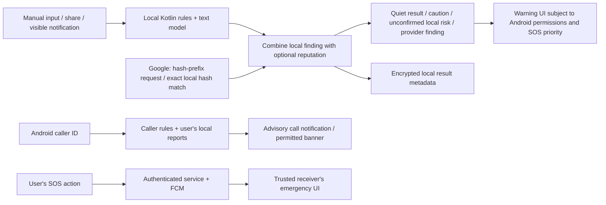

# root-security

**Your all-in-one family safety companion.**

root-security combines family SOS, message/link checks, caller-ID cautions and practical next steps in one Android app. The current submission target is **3.2-final** (version code 8). Its application ID remains `com.asrcodes.dontmissmom` so a correctly signed update can preserve an existing installation.

Development continues in the public [ASRcodes/root-security repository](https://github.com/ASRcodes/root-security). The earlier DontMissMOM checkout is historical; make future changes in root-security. Get the debug-signed hackathon APK from [release v3.2-final](https://github.com/ASRcodes/root-security/releases/tag/v3.2-final). Use [Final submission](docs/FINAL_SUBMISSION.md) for the exact verification record and [Demo script](docs/DEMO_SCRIPT.md) for the judge rehearsal. The recorded checks include 139 passing JVM tests (one optional test skipped), 33 distinct Android checks across API 36 and API 26 runs, an Android call-screening callback from a simulated call, and the production notification-listener path from simulated SMS. Live Google reputation, physical-carrier behavior and cloud SOS delivery are separate, unverified checks for this artifact.

On the sign-in screen, choose **Open protection without sign-in** to enter the local protection home. Message/file checks, the demo lab and Call Shield do not require a family account. Family SOS still requires sign-in, and automatic checks/Call Shield still require the relevant Android permissions. If already signed in, use the **Protection** tab.

## What the application contains

- **Family SOS:** approved contacts, emergency notifications, optional location and a short voice message, callback, playback and emergency history.
- **Message/link protection:** manual checks, Android share input and supported notification previews. Explainable local rules and a local text model produce cautious or unconfirmed high-risk findings; optional Google Safe Browsing supplies known-threat reputation.
- **Call Shield:** optional Android call-screening role, caller-ID cautions and a manageable list of numbers the user reported locally. Calls continue ringing normally. It does not analyze call audio, detect cloned voices, record or automatically block calls.
- **Family support:** understandable reasons, English/Hindi/Punjabi UI and warning audio, a family code-word aid and separate opt-in guardian support.
- **File/APK inspection:** limited file and APK risk checks. This is not a full antivirus or automatic malware-removal product.
- **Honest demonstrations:** harmless reserved `.example` inputs go through the real local rules. They are labelled as test inputs and cannot trigger guardian actions. A separate alert preview is explicitly a simulation.

Unknown or international caller IDs are cautions, not proof of fraud. Stronger caller warnings require the user's own report. Android normally excludes saved contacts and hidden/restricted numbers from screening. A familiar caller ID can still be spoofed.

## Stack and source map

| Area | Implementation |
|---|---|
| Android | Kotlin 2.2.20, Java 17 toolchain, Android Gradle Plugin 8.13.2; minimum API 26, compile/target API 36 |
| Host UI | Android activities, XML/Material layouts, ViewModels, LiveData and Kotlin coroutines |
| Protection UI | Jetpack Compose, Material 3, StateFlow, lifecycle-aware state |
| `app/` | Account, trusted circle, SOS, cloud repository, FCM receiver and host navigation |
| `protection/` | Android protection screens, notification listener, caller screening, warning delivery, Room/SQLCipher history and Android Keystore-backed secrets |
| `protection-core/` | Pure Kotlin URL parsing, rules, text/model scoring, caller rules, file rules, shared demo inputs and tests |
| Cloud | Firebase Authentication, Cloud Firestore and FCM; the configured SOS HTTP service and Cloudinary voice upload |
| `functions/` | Node.js 22 / Firebase Functions code for the optional Firestore alert-trigger path; separate from the configured SOS HTTP service |
| Verification | JUnit, Android instrumentation/UI Automator, lint, APK signature and alignment checks |

The text model uses character 3–5-gram TF-IDF features with logistic regression, evaluated locally from exported assets. The old URL ExtraTrees forest remains a diagnostic/parity asset and does not determine URL verdicts because it learned a benign deep-link bias. There is no LLM in the link-checking path, and Google's internal model architecture is not claimed as our own.



The existing SOS HTTP backend is an external deployment dependency; rebuilding this Android project does not deploy that backend, Firebase Functions or the Play Store.

## Data and privacy boundaries

| Data | Where it goes |
|---|---|
| Message text and complete submitted URL | Used in memory by local checks; not saved in protection history or sent to Google by the reputation client |
| Protection history | Encrypted on the phone: domain, result, reasons and time; bounded retention and record count |
| Google reputation request | Four-byte URL-hash prefixes over HTTPS; returned full hashes are matched locally. Google can see IP address and request metadata |
| User-supplied Safe Browsing key | Encrypted using Android Keystore-backed storage on the phone; supplied directly in app settings, not embedded in source or the APK |
| Reported caller numbers | Private app SharedPreferences on the phone, capped at 200, with individual removal and clear-all controls; separate from encrypted history |
| Accounts, family relationships, SOS location/voice | Existing Firebase/service/media flows with their own permissions and consent |

A completed Google no-match is not a safety guarantee. Failed or unavailable lookups remain **Not checked**. Short links are checked as submitted; destinations and redirects are not opened. The complete application is not offline or anonymous. Notification scanning only sees supported visible previews.

## Build locally

1. Install Android Studio, JDK 17 and Android SDK 36; use the included Gradle wrapper.
2. Add your own matching Firebase Android configuration at `app/google-services.json`. It is ignored by Git. Configure sign-in and certificate fingerprints in that Firebase project.
3. Configure your own cloud deployment endpoints/media setup if running the family SOS flows. Do not assume a fresh Firebase project can use another deployment's accounts or data.
4. For optional Google checks, enable Safe Browsing API in the key's Google Cloud project, restrict the key to that API, and enter it directly under **Protection settings → Online link protection**. Saved configuration alone is not a successful lookup.

```powershell
.\gradlew.bat :protection-core:test :protection:testDebugUnitTest :app:testDebugUnitTest :app:assembleDebug :app:lintDebug :protection:lintDebug
```

The debug APK is generated at `app/build/outputs/apk/debug/app-debug.apk`. Run reset-capable instrumentation only on a disposable emulator; see the explicit-device commands in [Demo script](docs/DEMO_SCRIPT.md). Call Shield requires Android 10/API 29 or later plus a supported screening role, even though other app features support API 26.

Release signing uses ignored local `keystore.properties` or the `DMM_KEYSTORE_*` / `DMM_KEY_*` environment variables. Never commit keystores, passwords, service-account files, private API keys or Cloudinary secrets. The existing Safe Browsing integration is for a noncommercial prototype; assess [Google's terms](https://developers.google.com/safe-browsing/terms) and an appropriately licensed service before commercialization.

## Evidence, history and attribution

[Judge brief](docs/JUDGE_BRIEF.md) covers the current architecture, next-six-hour priorities and eight likely judge questions with answers.

[Final submission](docs/FINAL_SUBMISSION.md) is the current status record. Older documents—including `PROTECTION_INTEGRATION.md`, `ROOT_SECURITY_URL_CHECKS.md`, `ROOT_SECURITY_RESEARCH_AND_PITCH.md`, `RELEASE_2_1.md`, `V2_*` and earlier JSON/test reports—are historical snapshots. Their feature descriptions, test totals and prior HTTP 403 observations must not be presented as verification of 3.2-final.

This application builds on DontMissMOM, originally credited to [Anubhav Singh / ASRcodes](https://github.com/ASRcodes), and the Suraksha Kavach protection module. The existing [protection module license](protection/LICENSE) is preserved. This README does not grant a new repository-wide license or replace existing third-party notices.
