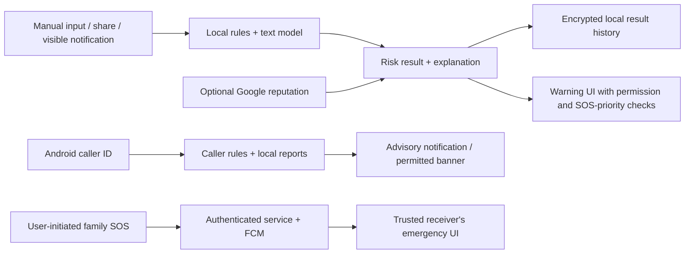

# root-security

**Your all-in-one family safety companion.**

root-security is a native Android application that brings family emergency alerts, message and link protection, caller-ID cautions, and local security history into one place. It helps users recognize risk signals, understand a warning, and reach trusted family members when they need support.

**Final submission: 3.2-final · Version code 8**

[Download the APK](https://github.com/ASRcodes/root-security/releases/download/v3.2-final/root-security-3.2-final.apk) · [Release notes](https://github.com/ASRcodes/root-security/releases/tag/v3.2-final) · [Verification record](docs/validation/final-evidence.json) · [Open Innovation presentation](docs/presentation/root-security-open-innovation.pptx)

The published APK is debug-signed for evaluation. Android 8.0 / API 26 or later is required; Call Shield requires a supported Android 10 / API 29+ call-screening role.

## Contents

- [Features](#features)
- [How protection works](#how-protection-works)
- [Architecture](#architecture)
- [Technology stack](#technology-stack)
- [Privacy and data handling](#privacy-and-data-handling)
- [Getting started](#getting-started)
- [Build from source](#build-from-source)
- [Release validation](#release-validation)
- [Future development](#future-development)
- [Attribution and licensing](#attribution-and-licensing)

## Features

| Feature | What it provides |
|---|---|
| **Family SOS** | Emergency alerts to approved contacts, optional location and a short voice message, callback, playback, and emergency history. |
| **Message and link protection** | Manual checks, Android share input, and automatic checks of supported notification previews. Findings include understandable reasons and distinguish local risk signals from online reputation. |
| **Call Shield** | Caller-ID cautions and a manageable list of numbers reported by the user. Incoming calls continue ringing normally. |
| **Family support** | A family code-word aid and separately enabled guardian SMS support. |
| **File and APK inspection** | On-device checks for selected file and APK risk indicators. |
| **Accessible guidance** | English, Hindi, and Punjabi interfaces and warning audio. |
| **Local protection history** | Encrypted records of domains, risk results, reasons, and timestamps, with bounded retention. |
| **Built-in examples** | Harmless test inputs evaluated by the real local rules, plus a separately labelled alert preview. Test inputs and previews cannot trigger guardian actions. |

Local protection is available without an account. Family SOS requires sign-in and configured cloud services. Automatic notification checks, caller screening, and warning overlays each require their relevant Android permissions.

### Device compatibility

| Capability | Requirement |
|---|---|
| Install and use local protection | Android 8.0 / API 26 or later. |
| Call Shield | Android 10 / API 29 or later, an available call-screening role, and caller cautions enabled. |
| App alert notifications | Android notification settings; runtime notification permission on Android 13 / API 33+. |
| Full-screen presentation | Device/background policy and applicable special access; Android 14 / API 34+ access is checked separately. |

Telephony hardware is optional for installation. A tablet can use local checks without supporting cellular calls or carrier SMS.

## How protection works

1. **Local analysis:** Kotlin rules examine URL structure and message context. A local text model uses character 3–5-gram TF-IDF features with logistic regression. Weak formatting clues alone do not justify an intrusive threat warning.
2. **Optional reputation checks:** Google Safe Browsing receives four-byte URL-hash prefixes over HTTPS. Returned full hashes are compared locally; the reputation client does not send message bodies or complete URLs.
3. **Clear results:** The app separates no local warning, caution, unconfirmed local high-risk findings, and provider findings. Failed or unavailable online checks remain **Not checked**.
4. **Actionable warnings:** Eligible high-risk findings can open a warning screen, subject to Android permissions, background restrictions, and emergency-priority handling. Local findings remain identified as unconfirmed.

The legacy URL ExtraTrees model is retained for diagnostic and parity checks; it does not determine URL verdicts. A quiet local result or a completed online no-match does not guarantee that a link is safe. Short links are checked as submitted; redirects and destination pages are not opened.

Call Shield evaluates caller ID supplied by Android using local rules and the user's reported-number list. Unfamiliar or international numbers receive cautious advice; stronger wording identifies the user's own report. It does not analyze or record call audio, detect cloned voices, or automatically block calls. Caller ID can be spoofed, and Android normally excludes saved contacts and hidden or restricted numbers from screening.

### Connectivity requirements

| Feature | Network requirement |
|---|---|
| Bundled message/link rules, selected file checks, family code and local history | Local processing, with the relevant engine, storage and file access available. |
| Google reputation | Internet access, configured key and enabled online checks. |
| Family SOS cloud delivery | Connectivity and the configured account, backend and push services. |
| Guardian SMS | Carrier SMS service and its separate permission/settings; mobile data is not the delivery channel. |

The offline Family SOS fallback can open the phone's SMS composer for one eligible contact. The user sends that carrier message; it is separate from cloud SOS delivery and automatic guardian SMS.

## Architecture



| Module | Responsibility |
|---|---|
| `app/` | Authentication, trusted contacts, family SOS, cloud repository, FCM reception, and application navigation. |
| `protection/` | Protection screens, notification listener, call screening, warning delivery, local history, and secure key storage. |
| `protection-core/` | Pure Kotlin URL parsing, rules, model scoring, caller and file checks, shared examples, and unit tests. |
| `functions/` | Node.js Firebase Functions for the optional Firestore alert-trigger route. |
| `security/` | Firestore security-rule tests. |

Family SOS uses a configured external HTTP service alongside Firebase and media services. Building this Android project does not deploy that backend or the optional Firebase Functions route.

## Technology stack

| Area | Technologies |
|---|---|
| Language and build | Kotlin 2.2.20, Java 17, Gradle 8.13, Android Gradle Plugin 8.13.2 |
| Android platform | Minimum API 26; compile and target API 36 |
| Application UI | Android activities, XML layouts, Material Components, ViewModels, and LiveData |
| Protection UI | Jetpack Compose, Material 3, StateFlow, and lifecycle-aware state |
| Asynchronous work | Kotlin coroutines |
| Local storage | Room with SQLCipher; Android Keystore-backed secret storage; private app preferences |
| Cloud services | Firebase Authentication, Cloud Firestore, Firebase Cloud Messaging, configured SOS HTTP service, and Cloudinary voice upload |
| Optional backend route | Node.js 22 and Firebase Functions |
| Validation | JUnit, Android instrumentation, UI Automator, lint, APK signature verification, and alignment checks |

## Privacy and data handling

| Data | Handling |
|---|---|
| Message text and complete submitted URL | Processed in memory; not saved in protection history or sent to Google by the reputation client. |
| Protection history | Encrypted on the phone; stores domain, result, reasons, and time with retention and record-count limits. |
| Reputation requests | URL-hash prefixes sent over HTTPS. Google can also see the IP address and request metadata. |
| Safe Browsing API key | Entered in app settings and encrypted using Android Keystore-backed storage. It is not embedded in the source or distributed APK. |
| Reported caller numbers | Stored in private app preferences, separately from encrypted history; capped at 200 with individual removal and clear-all controls. |
| Guardian support | When separately enabled and eligible, sends a generic carrier SMS to the saved guardian number without the scanned message or URL. |
| Accounts, family relationships, SOS location, and voice | Use the configured Firebase, HTTP service, and media flows with their own permissions and consent. |

Notification scanning is limited to supported visible previews. Local history does not make the entire application offline or anonymous; reputation and family services use network connections.

## Getting started

1. Install the [published APK](https://github.com/ASRcodes/root-security/releases/tag/v3.2-final).
2. Choose **Open protection without sign-in** for local protection, or sign in to use family features. Signed-in users can open the **Protection** tab.
3. Enable the Android permissions for the features you want: notification access for automatic message checks, notifications for alerts, and the call-screening role for Call Shield. Overlays require separate permission and the app's overlay setting.
4. To enable online checks, enter a Safe Browsing API key under **Protection settings → Online link protection**. The API must be enabled in the key's Google Cloud project, with compatible key restrictions.
5. Configure approved contacts and the required cloud services for Family SOS. For guardian support, save a guardian number, enable the option, and grant SMS permission.

### Permission reference

| Android access | Used for |
|---|---|
| Notification access | Reading supported visible notification previews for automatic checks; this is not SMS-inbox access. |
| Notifications | Displaying app alerts; separate from notification-listener access. |
| Call-screening role | Receiving caller IDs that Android makes available to Call Shield. |
| Draw over other apps | Optional warning banners, together with the app's overlay setting. |
| Microphone | A user-initiated SOS voice attachment, not telephone-call audio. |
| Approximate or precise location | Optional location attached to a family SOS. |
| Send SMS | Separately enabled guardian support to a saved number. |
| File or folder picker grant | Reading only the selected content URI or folder; no broad storage permission is requested. |

Start with local manual checks, then enable access for the additional features you choose to use.

## Build from source

Install Android Studio, JDK 17, and Android SDK 36, then clone this repository:

```powershell
git clone https://github.com/ASRcodes/root-security.git
cd root-security
```

Add your Firebase Android configuration at `app/google-services.json` and configure the corresponding sign-in providers and signing-certificate fingerprints. The application ID is `com.asrcodes.dontmissmom`. Configure your own backend endpoints and media setup for family SOS. Firebase configuration, signing files, and local secrets are excluded from Git.

Build the APK and run the JVM and lint checks:

```powershell
.\gradlew.bat :protection-core:test :protection:testDebugUnitTest :app:testDebugUnitTest :app:assembleDebug :app:lintDebug :protection:lintDebug
```

Output: `app/build/outputs/apk/debug/app-debug.apk`.

Release signing uses an ignored `keystore.properties` file or the `DMM_KEYSTORE_FILE`, `DMM_KEYSTORE_PASSWORD`, `DMM_KEY_ALIAS`, and `DMM_KEY_PASSWORD` environment variables. Updating an existing installation requires a matching signing certificate. Run instrumentation that can reset application data only on a disposable emulator.

## Release validation

The recorded results apply to the published **v3.2-final** APK:

| Check | Recorded result |
|---|---|
| JVM tests | 139 passed; one optional test skipped. |
| Android checks | 33 distinct checks have passing final results across an initial API 36 run and targeted API 26 retries. |
| Lint | Zero errors; warnings and hints remain in the recorded report. |
| APK integrity | Signature verification and 16 KB alignment checks passed; SHA-256 is recorded with the release. |
| Incoming SMS path | A simulated normal SMS produced no warning; the reserved high-risk example reached the production notification listener and opened a labelled warning. |
| Incoming call path | A simulated radio call reached Android's screening callback and produced the local reported-number warning. |

See the [machine-readable verification record](docs/validation/final-evidence.json) and [APK verification output](docs/validation/apk-verification.txt) for details. The Android results are accumulated across runs, not one clean full-suite run. Live Google reputation, physical-phone/carrier behavior, and deployed cloud SOS delivery remain unverified for this release. Test totals do not establish a detection-accuracy percentage.

## Future development

- Evaluate false positives and missed threats on representative multilingual messages and links.
- Improve notification and warning reliability across devices, Android versions, and accessibility settings.
- Extend redirect and destination assessment while preserving privacy and clear uncertainty.
- Strengthen production credential management, cloud deployment, and end-to-end family-alert delivery testing.

File/APK checks cover selected risk indicators and do not provide complete antivirus scanning. Warning presentation and emergency delivery depend on device permissions, operating-system policy, connectivity, and configured services.

## Attribution and licensing

root-security builds on DontMissMOM, originally credited to [Anubhav Singh / ASRcodes](https://github.com/ASRcodes), and the Suraksha Kavach protection module. The existing [protection module license](protection/LICENSE) and third-party notices are preserved; this README does not establish a new repository-wide license. Review the [Google Safe Browsing terms](https://developers.google.com/safe-browsing/terms) for the intended deployment.
