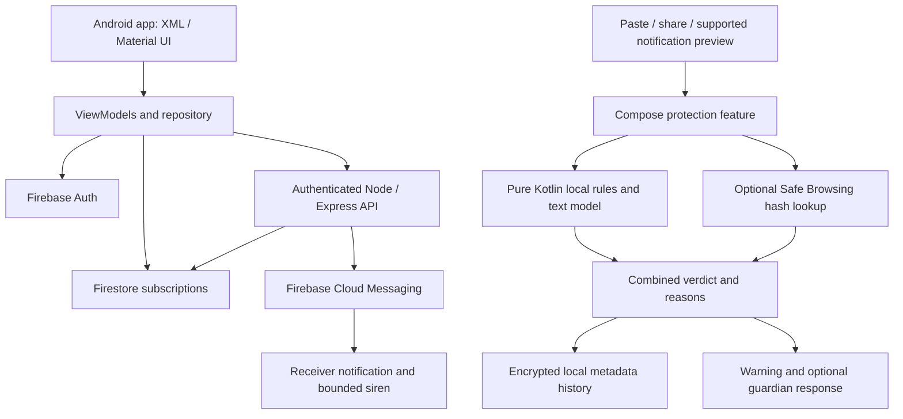

**Root Security: judge preparation and code review — 21 November 2026**

This guide describes the current working tree in DontMissMOM, whose application ID remains `com.asrcodes.dontmissmom` and whose declared version is `3.1-mvp` (code 7). The app name is now Root Security. Git does not identify which uncommitted edits Claude authored, so this review covers the current candidate changes and labels known pre-existing issues separately.

The separate HTTP service at `C:/Users/rajsi/OneDrive/Desktop/DontMissMOM-Push` was also inspected read-only. Application code and deployment configuration were not changed. No live SOS, SMS, email, or deployment was performed.

**The project in one sentence**

Root Security is an Android family-safety application that combines trusted-contact emergency alerts with explainable message/link risk checks, limited file/APK inspection, and optional family-response tools.

**Current technology stack**

| Area | Implementation | Purpose and limit |
|---|---|---|
| Android language/build | Kotlin 2.2.20; Java/JVM 17 target; Gradle 8.13; Android Gradle Plugin 8.13.2 | Native Android; minimum API 26, target/compile API 36. |
| Main app interface | XML layouts, Android Views, Material Components 1.13.0, RecyclerView, bottom navigation | Home, Circle, Protection, History and Settings. |
| Protection interface | Jetpack Compose, Material 3, Compose BOM 2025.10.01 | Separate Android feature library, integrated into the same APK/process. |
| Application state | ViewModel/LiveData in the host; coroutines/StateFlow in protection | Retains UI state and observes asynchronous work. Dependency wiring is manual. |
| Authentication | Google sign-in through Firebase Authentication | Authenticates the account. Typed Indian mobile numbers are normalized/reserved, not OTP-verified. |
| Cloud database | Cloud Firestore with snapshot listeners and server transactions | Profiles, contact requests, trust relationships, emergency history and delivery bookkeeping. |
| Main HTTP service | Node.js 22 declared; Express 5.2.1; Firebase Admin 14.5.0; Render deployment described in project configuration/docs | Verifies bearer tokens, mutual trust and blocks; applies send limits and duplicate prevention. |
| Push delivery | Firebase Cloud Messaging, high-priority data messages | Receiver notification and foreground siren. Acceptance is not proof of delivery. |
| Optional alternate sender | Firebase Functions 7.4.0, Firestore creation trigger on alerts/{id} | Separate legacy route; must not be confused with the main HTTP service. |
| Location | Google Play Services Fused Location Provider 21.3.0 | Optional alert attachment. Map opens through an external Maps/web intent. |
| Voice | Android MediaRecorder/MediaPlayer; Cloudinary unsigned upload preset | Up to five seconds of recorded audio; cloud-hosted media is not end-to-end encrypted. |
| Local detection | Kotlin weighted rules, public-suffix/domain checks, character n-gram TF-IDF plus logistic-regression text model | Explainable local risk classification. No LLM is used. |
| URL reputation | Optional Google Safe Browsing v5 hashes.search over HTTPS | Sends four-byte hash prefixes; exact returned full hashes are matched locally. |
| Local protection history | Room 2.8.5 and SQLCipher 4.10.0 | Encrypted domain, verdict, reason codes and timestamp; not full message bodies. |
| Local secrets | Android Keystore AES-GCM; salted PBKDF2-HMAC-SHA256 for family code | Protects selected secrets. Not every ordinary setting is encrypted. |
| Android integrations | NotificationListenerService, CallScreeningService, notification/overlay permissions, JobScheduler | Preview-based scanning, caller-ID advice, optional bounded folder checks. |
| Testing | JUnit, Espresso, UI Automator, Compose tests, Android lint, Node test runner, Firebase Rules emulator tests | Regression and integration evidence, not measured real-world fraud accuracy. |

The bundled Extra Trees URL model is still loaded for compatibility/diagnostics, but its score is not used for current verdicts because the earlier model learned a misleading URL-path shortcut. Python audit scripts exist; runtime inference is Kotlin over bundled JSON assets, not TensorFlow Lite or a remote AI API.

**Architecture you can explain at the whiteboard**

This is a modular Android application with a partly MVVM host, an Android protection feature library, a pure Kotlin detection core, and a separate cloud backend. It is not a fully uniform Clean Architecture implementation: activities and the protection Application object still coordinate substantial work.

**Emergency flow**

1. A user signs in through Google/Firebase and enters a phone number.
2. A contact request establishes a mutually approved relationship.
3. The sender selects a contact or circle and may attach location and a five-second voice note.
4. The app sends a Firebase ID token and stable alert ID to `/v2/sendEmergency`.
5. The server derives identity from the authenticated profile, checks mutual trust, blocks, limits and the alert reservation, and writes history.
6. FCM delivers the data payload; the receiving app posts an actionable notification and attempts a media-playback foreground siren with a five-minute timeout.
7. The popup offers callback, map, voice playback and dismissal. A foreground Firestore listener is an additional route while the Home activity is started.

Device receipt/siren status writes already exist in `AlertReceipt`. They do not establish that a person has seen or responded to the emergency, and are not a verified sender-visible acknowledgement/escalation system. Stable IDs prevent duplicate submissions; they do not guarantee exactly-once delivery across Firestore and FCM.

Offline SOS opens the SMS composer for one selected contact and requires the user to send. It does not deliver FCM or automatically activate the recipient app's siren.

**Protection flow**

1. The user pastes/shares text, or Android supplies a supported app's visible notification preview.
2. The pipeline bounds input, extracts URLs and suppresses recent duplicate messages.
3. Local rules assess impersonation, suspicious host structures and scam language; the text model adds a statistical signal.
4. If enabled and configured, Safe Browsing checks up to six extracted URLs within a bounded lookup budget. It does not open destinations or follow redirects.
5. Local and online evidence are combined with reason codes. A failed online lookup is shown as Not checked.
6. Metadata enters encrypted local history. Background dangerous results can produce intrusive warnings and consented guardian SMS; manual scans and labelled test fixtures do not send guardian SMS.

**Important correction to the old pitch:** current local rules can produce `DANGEROUS + LOCAL_RISK`, including full-screen/guardian behavior. The existing README/research brief still describes an older Google-only URL-danger policy. Present the current design as a hybrid of local rules/text ML and optional reputation. A local danger result is not a Google-verified threat.

Protection history defaults to seven days, supports 1/7/30-day retention, and is capped at 500 records. Emergency history is a separate Firestore data flow. Saying “all data stays on the phone” would be inaccurate.

**Review of the candidate changes**

The strongest improvements are modular separation, testable domain logic, repository-backed UI, authenticated v2 HTTP transport, stable alert IDs, bounded siren duration, optional attachments, encrypted protection history, and explicit unavailable-provider states. The candidate is not ready for an unqualified “all checks pass” claim.

| Priority | Finding and evidence | Recommended correction |
|---|---|---|
| P1 | Appending an ordinary URL suppresses an independently dangerous OTP scam. The text “Your account will be blocked. Share your OTP immediately to verify your account” scores DANGEROUS/.75; adding https://www.google.com or https://example.com/ produces SUSPICIOUS/.50. Reproduced against compiled Kotlin and bundled assets. | Preserve standalone message danger when combining URL evidence; test appended benign/trusted URLs. |
| P2 | Expiring a Google-positive result also erases independent LOCAL_RISK danger. Reproduced a locally dangerous lookalike result becoming internal SAFE/.0 with Not checked after 30 minutes. | Retain separate local/provider evidence; expire only online evidence. |
| P2 | Required protection lint fails at CallShieldSettings.kt lines 40 and 42 for API-29 RoleManager calls in an API-26-minimum module. | Use a directly recognized SDK-guarded branch/API-specific helper. The existing nullable guard suggests a lint-analysis limitation; this finding does not prove an API-26 runtime crash. |
| P2 | The optional legacy Function validates voice ownership for history but sends the original unsanitized FCM payload. Reproduced: rejected history voice, but the same other-owned URL remains in push data. | Return the authorized attachment from reservation and build FCM from it, or reject consistently. |
| P2 | Direct trusted-client Firestore alert creation bypasses HTTP send limits. Fresh IDs reach the foreground observer and, if deployed, the legacy Function. | Make v2 alert creation server-owned or share a transactional quota across every delivery path. |
| P2 | All emergency notifications reuse ID 1001 with onlyAlertOnce=true. A second distinct SOS can update silently if the first notification remains and the foreground siren cannot start. | Suppress repeat sound for the same event, not every event. Source-confirmed condition; not reproduced on a phone in this review. |
| Existing privacy gap | Logout stops the siren but leaves its notification; popup rendering does not check current recipient account. A saved prior-account alert can reopen contact/location/voice details. This appears to predate Claude's latest work. | Cancel account-bound notifications on logout; validate recipient UID before rendering or playing media. |
| Documentation | Existing claims that local evidence never produces URL danger are stale. | Update the README, pitch and validation record together with the policy decision. |

Source locations for review:

- [MessagePipeline.kt](../protection-core/src/main/kotlin/org/suraksha/core/MessagePipeline.kt), line 32; [VerdictEngine.kt](../protection-core/src/main/kotlin/org/suraksha/core/VerdictEngine.kt), lines 41–49.
- [ReputationPolicy.kt](../protection-core/src/main/kotlin/org/suraksha/core/ReputationPolicy.kt), lines 30–33.
- [CallShieldSettings.kt](../protection/src/main/kotlin/org/suraksha/kavach/ui/CallShieldSettings.kt), lines 40–42.
- [functions/index.js](../functions/index.js), lines 23–33; [legacyHistory.js](../functions/legacyHistory.js), lines 14–21.
- [firestore.rules](../firestore.rules), lines 50–53; [ForegroundAlertObserver.kt](../app/src/main/java/com/asrcodes/dontmissmom/ForegroundAlertObserver.kt), line 20.
- [AlertDelivery.kt](../app/src/main/java/com/asrcodes/dontmissmom/AlertDelivery.kt), lines 32 and 63.
- [MainActivity.kt](../app/src/main/java/com/asrcodes/dontmissmom/MainActivity.kt), lines 401–408; [AlertPopupActivity.kt](../app/src/main/java/com/asrcodes/dontmissmom/AlertPopupActivity.kt), line 43.
- [Existing research/pitch](ROOT_SECURITY_RESEARCH_AND_PITCH.md), lines 39–43; [KavachApplication.kt](../protection/src/main/kotlin/org/suraksha/kavach/KavachApplication.kt), lines 179–210.

**Deployment evidence and test results**

Fresh Gradle validation completed the unit-test and debug-APK tasks, with some outputs reused as up-to-date. The combined command failed at protection lint.

| Check | Result |
|---|---|
| App JVM suite | 18 passed |
| Protection JVM suite | 17 passed |
| Protection-core JVM suite | 88 passed, 1 skipped |
| Total JVM report | 123 passed, 1 skipped, no test failures |
| Debug APK | Assemble task succeeded/up-to-date |
| App lint | No errors; 103 warnings and 2 hints |
| Protection lint | FAILED: 2 errors and 26 warnings |
| Functions Node suite | 4 passed |
| Separate HTTP backend Node suite | 33 passed |
| Firestore emulator security tests | Inspected, not rerun; Firebase CLI stalled during startup |
| Physical-device and live provider checks | Not rerun in this review |

Node tests ran using installed Node v24.11.0; the repositories declare Node 22. Recheck under the deployment runtime before release.

The prior saved validation record reports HTTP 403 from the last three live Google lookups and no verified live incoming reputation warning. This is historical evidence, not a new live attempt. The updated code may pass mocked handling tests while provider configuration remains unresolved.

September release/security notes record permissive production Firestore rules and undeployed private replacements. The current live rule set was not inspected here. The separate backend retains a legacy unauthenticated phone-based route unless disabled. Therefore “all production data is private” and “every alert is authenticated” remain unverified claims. Coordinate any migration with existing users; do not blindly deploy incompatible rules.

**A realistic six-hour improvement sprint**

Treat these as target time boxes for one developer, not a promise of production readiness. If a critical item overruns, drop cosmetic work first.

| Time | Work | Evidence required at the end |
|---|---|---|
| 0:00–1:00 | Fix the text-plus-link downgrade, provider-expiry downgrade and API lint guards. | Focused regressions pass; protection lint has zero errors. |
| 1:00–2:00 | Fix logout notification isolation and distinct-SOS notification fallback. Correct legacy voice payload sanitization if that route is retained. | Account A cannot reopen its alert under account B; distinct alerts retain fallback behavior; rejected audio is absent from both history and push. |
| 2:00–3:00 | Resolve Safe Browsing setup: inspect enabled API/project/restrictions/quota, then run official harmless fixture and failure cases. | Observed live match, benign no-match and offline/error Not checked, or an explicitly documented remaining blocker. |
| 3:00–4:00 | Verify current backend/rules against intended release; run isolated security tests; check token rejection, blocked contact and direct-write paths. | Record deployed versions and rule state. Decide coordinated migration; do not call local code deployed. |
| 4:00–5:00 | Rehearse on two consenting test phones: trust request, SOS, locked/background receiver, voice/location, mute/timeout and offline SMS composer. | A short result matrix with observed receipt/siren state and measured timings; one repeatable demo. |
| 5:00–6:00 | Refresh documentation, rebuild/check the exact demo APK, freeze features and rehearse presentation. | Correct architecture slide, known limitations, fallback preview labelled simulation, saved demo recording and APK checksum. |

If live setup cannot be fixed promptly, demonstrate the actual local detector and clearly labelled preview rather than inventing a successful provider result. Do not spend this six-hour window on new model training, iOS support, live voice-clone analysis or payment integrations.

**Future scope after the demo**

- Receiver-to-sender human acknowledgement, missed-response escalation, durable retry state and measured end-to-end delivery latency.
- OTP-verified phone ownership, legacy endpoint retirement, private-rule migration, shared rate limits and operational monitoring.
- Better evaluation: representative benign deep links, unseen domains/time windows, language-specific precision/recall, false-positive rate and user feedback.
- Signed/versioned model and threat-intelligence updates, with rollback and independent evaluation before enabling new alarm authority.
- Signed/restricted media uploads, documented voice retention, and a separately designed end-to-end encryption option.
- Consent-based family sharing, accessibility testing with older adults, and field validation of local-language explanations.
- More complete APK intelligence with vetted feeds and measured coverage; platform-specific feasibility work before iOS expansion.

Commercial URL checking requires a suitable licensed service: Google's Safe Browsing API is for non-commercial use; Google directs commercial uses to Web Risk. [Google's official overview](https://developers.google.com/safe-browsing/reference).

**Likely judge cross-questions and suggested answers**

1. **What problem are you solving?**  
   “Families often need help deciding whether a worrying message is a scam and then reaching someone they trust. We combine understandable checks with a separate trusted-contact SOS pathway.”

2. **Why native Android/Kotlin?**  
   “The core workflow depends on Android notifications, foreground services, call-screening roles and device permissions. Kotlin gives us direct platform integration and a testable shared domain module.”

3. **What is the architecture?**  
   “A modular Android app: the host uses ViewModels and a repository; protection has an Android integration/UI module and a pure Kotlin core. Firebase handles identity/data/push, while a Node API enforces privileged emergency operations.”

4. **Why both XML and Compose?**  
   “The existing emergency app uses XML. We added the protection feature in Compose without rewriting the stable host at the same time.”

5. **Where is the AI? Is it ChatGPT?**  
   “The app uses a small local character TF-IDF/logistic-regression text classifier alongside explainable rules. It does not call ChatGPT or another LLM for verdicts. Google supplies optional known-threat URL reputation.”

6. **What happened to the old URL model?**  
   “We found that benign URLs with paths could score as dangerous because of training-data structure. That model is excluded from current verdict decisions. Local rules and optional reputation now provide the active URL signals.”

7. **Are your warnings verified by Google?**  
   “Only warnings carrying a successful exact Google reputation match. Current local rules can independently flag risk, and we distinguish those explanations from provider evidence.”

8. **What is your accuracy?**  
   “We do not yet have a defensible field-accuracy number. Automated regression counts are not accuracy. We need independent, representative evaluation with false-positive rate, recall and language-specific results.”

9. **Can a safe-looking URL hide a scam?**  
   “Yes. A legitimate domain does not make the surrounding request legitimate. Our review found an appended-link downgrade bug, which must be fixed and regression-tested before we claim that case is handled.”

10. **What makes it different from existing scam apps?**  
    “Our hypothesis is that combining understandable risk explanations, local-language support, family verification and trusted SOS in one workflow helps families act. We are not claiming invention of scam detection or a proven market advantage.”

11. **Does it read WhatsApp chats?**  
    “It sees supported notification previews after permission, or text explicitly shared/pasted by the user. It cannot read the full private chat database or hidden previews.”

12. **Does it listen to calls or detect cloned voices?**  
    “No. Call Shield uses caller-ID heuristics and user-reported numbers. It advises the user and allows calls through. The family code is a manual verification aid.”

13. **Is the APK scanner an antivirus?**  
    “No. It checks hashes and APK manifest risk indicators without executing the file. The bundled known-bad sample is the harmless EICAR test, so we cannot claim comprehensive malware coverage.”

14. **What works offline?**  
    “Local text/rule checks and file inspection work offline. Google reputation and cloud SOS need internet. The emergency fallback opens a user-sent SMS composer; optional guardian SMS is a separate carrier feature.”

15. **Can you guarantee emergency delivery?**  
    “No. The service can confirm push acceptance, and the app has device-status writes, but network, permissions and OS restrictions affect receipt. Human acknowledgement and escalation are future work.” High priority attempts immediate delivery; it is not an end-to-end guarantee. [Firebase documentation](https://firebase.google.com/docs/cloud-messaging/android-message-priority).

16. **Will an alert always open full screen or bypass DND?**  
    “No. Full-screen access, notifications, alarm volume, DND settings and device restrictions matter. We provide setup/status guidance and notification fallback.” Android 14+ imposes specific full-screen access restrictions. [Android documentation](https://developer.android.com/about/versions/14/behavior-changes-14#secure-fsi).

17. **How do you prevent spam or fake senders?**  
    “The v2 API checks Firebase identity, both sides of the trust relationship, blocking, limits and stable alert IDs. The legacy route and direct-write paths still need migration/hardening, so we would not claim all routes already have equivalent protections.”

18. **Are phone numbers verified?**  
    “The Google account is authenticated. The current Indian phone number is format-checked and uniquely reserved, not verified by OTP.”

19. **What data leaves the device?**  
    “Sign-in, profiles, trust relationships and SOS history use Firebase; optional emergency voice uses Cloudinary and location is shared with the recipient. Reputation sends URL hash prefixes. Protection history itself stays encrypted locally.”

20. **Is hashing anonymity?**  
    “No. Hash prefixes reduce raw-URL disclosure, but direct HTTPS still exposes our device IP to the provider. We do not claim anonymity or a deployed privacy relay.”

21. **Is everything encrypted end to end?**  
    “No. Local protection history and selected secrets are encrypted, and transport uses HTTPS. Existing cloud emergency/voice sharing is not an E2EE design.”

22. **Why do you need Node if Firebase exists?**  
    “The server owns privileged decisions: identity validation, trust, rate limits, duplicate reservations and push sending. Those checks must not depend only on an honest mobile client.”

23. **How do you handle retries?**  
    “We retain the alert ID and reserve it transactionally. Ambiguous sends remain unconfirmed rather than being blindly resent. This reduces duplicates but does not create exactly-once delivery.”

24. **Can the system scale?**  
    “Managed Firestore and FCM help, but the HTTP service, history maintenance, indexes, quotas and costs still need load testing. We have not benchmarked a large production user count.”

25. **What if Google is unavailable?**  
    “Local evidence remains available and online status becomes Not checked. A failed request is not a clean result. The last recorded live run returned 403, so we must verify configuration before claiming a live demo.”

26. **What can you improve in six hours?**  
    “Fix reproduced classification and privacy bugs, make lint pass, verify one live provider case and one two-phone SOS flow, and freeze an honest demo with recorded evidence.”

27. **What did your team build rather than use from vendors?**  
    “Our contribution is the Android integration, local scoring/policy, evidence presentation, family workflows, encrypted local history and emergency orchestration. Google/Firebase/Cloudinary provide specific infrastructure and reputation capabilities.”

28. **Did you use Claude or other coding assistants?**  
    If accurate for your team: “Yes, we used coding assistance. We remain responsible for understanding, reviewing and testing the resulting code. Our review caught failures that passing unit tests alone did not detect.”

**A 45-second pitch**

“Root Security helps families move from a worrying message to an understandable decision and a trusted person. Our Android app combines local scam-language and link-risk checks with optional Google threat reputation, plus trusted-contact SOS with location and a short voice note.

“We keep protection history encrypted on the device and show what is known, what is only a local risk signal, and what could not be checked. We also learned from a false-positive problem in an earlier URL model and removed that model from verdict authority.

“Our next milestone is reliable behavior on real phones: fewer false alarms, verified live checks, and clear acknowledgement when someone needs help.”

**Three-minute demo order**

- 0:00–0:25: Explain a family scenario and show Home/Protection.
- 0:25–1:00: Check an ordinary link and an obvious credential-request message; show reasons.
- 1:00–1:25: Show a successful official harmless Google test only if observed; otherwise use the explicitly labelled preview.
- 1:25–2:15: Demonstrate trusted-contact SOS on consenting test phones.
- 2:15–2:40: Show local protection history, family code and language option.
- 2:40–3:00: State test evidence, current limits and the next milestone.

Do not claim 99% accuracy, guaranteed delivery, universal chat access, real-time voice-clone detection, a full antivirus, whole-app offline operation, or end-to-end encryption.

